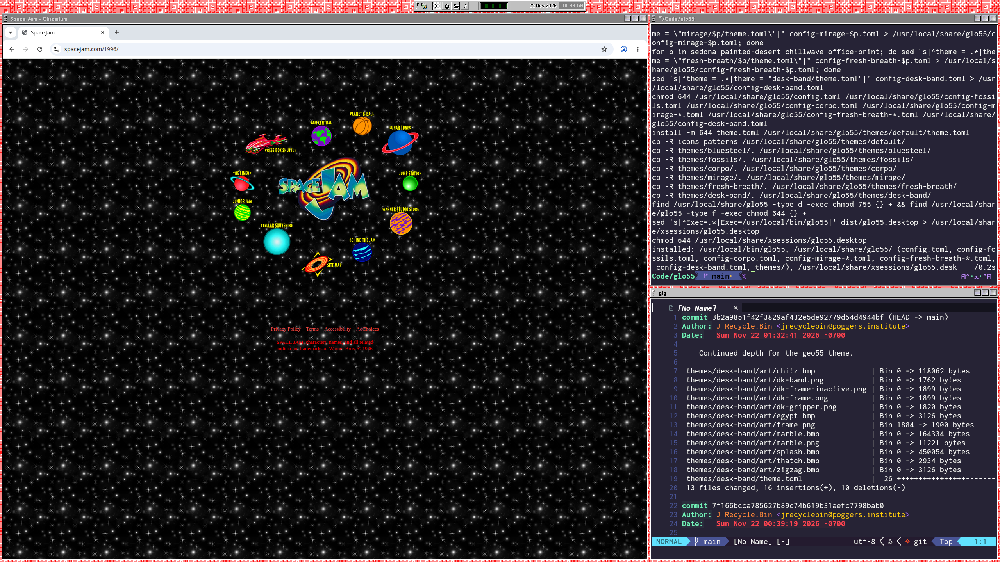

# ｇｌｏ５５ 


I **love** my tiling window managers - and was an original wmii/dwm user. But
I've missed the beautiful pixel-perfect themes found in old window managers like
Enlightenment - or those from LiteStep and Geoshell. Monumental desktop designs
that, somehow have been lost to time.

Take the Blue Steel theme above - isn't it a classic?? It's still gorgeous.

ｇｌｏ５５ is a love letter to those old pixelly themes - but brought into the
world of tiling window managers for X11. I will confess - I wanted to try Grok
Bot out (having watched Lauren Chen's recent talks and interviews) and wanted to
see how it would do. A few hours later I was using this.

It's written in [V](https://vlang.io), with configuration in TOML and an
element-based theme system (solid, gradient, image, pattern and text
elements). I originally laid out the design in summer of 2025 - and I still had
the [design.md](docs/design.md) handy.



## What works

- DWM-style master/stack tiling with `master_ratio`, gap and border width
- Per-monitor workspaces (Xinerama multi-monitor), each monitor with its own workspace list
- One or more themed toolbars per monitor (clickable workspace buttons, focused window title, clock), flowing across top rows
- Focus follows the mouse; the active monitor follows the pointer. Dialogs float above the tiled
  windows (focused or not), and closing a window gives focus back to the one that had it before
- Keybindings from `config.toml`: `workspace N`, `warp N`, `focus/move up|down|left|right`,
  `exec CMD`, plus `close`, `collapse`, `restore`, `quit`, `workspace next|prev`, `fullscreen`,
  `reload`, `restart`
- Collapse = roll up: the window shrinks to its title bar at the bottom of the stack (keeping its
  place in the stack for when it is restored) and the others fill the space; bars stay focusable
- Fullscreen (`Mod+f` or the title bar's rightmost button; `_NET_WM_STATE_FULLSCREEN` is set and
  client requests are honoured), `Mod+r` reloads config and theme in place, `Mod+Shift+r`
  restarts the WM with every window kept where it was
- Themes: `[vars]` with `$variable` substitution, `focused` state overrides, solid / gradient
  (any angle) / text / PNG image / tiled PNG pattern elements on window frames and toolbars
- Xft fonts (`XftFontOpenName`, UTF-8 via `XftDrawStringUtf8`)

## Build

Needs V (0.5.x) and the X11 dev packages:

    sudo apt install build-essential libx11-dev libxft-dev libxinerama-dev libxi-dev
    make            # builds ./build/glo55
    make test       # unit tests (layout, workspace/focus/move, config, theme, colour maths)

## Install

    make PREFIX=/usr                 # builds build/glo55 with PREFIX built in (default /usr/local)
    sudo make PREFIX=/usr install    # DESTDIR=... stages it for packaging
    sudo make PREFIX=/usr uninstall

| Installed | Where |
|---|---|
| binary | `$PREFIX/bin/glo55` |
| sample config (Blue Steel) | `$PREFIX/share/glo55/config.toml` |
| bundled themes: `default`, `bluesteel`, `fossils`, `corpo`, `fresh-breath` (each: sedona, painted-desert, chillwave, office-print; art, fonts, licence), and `geo55` | `$PREFIX/share/glo55/themes/` |
| X session entry for display managers | `$PREFIX/share/xsessions/glo55.desktop` |

Then plain `glo55` works from any directory. To customise, copy the config and edit it:

    mkdir -p ~/.config/glo55 && cp /usr/share/glo55/config.toml ~/.config/glo55/

`~/.config/glo55/config.toml` overrides the installed one. A `theme = "NAME/theme.toml"` is looked
up next to the config file, then in `~/.config/glo55/themes/`, then in the installed themes (so
`theme = "default/theme.toml"` switches to the plain theme, and your own themes can live in
`~/.config/glo55/themes/mytheme/`). `GLO55_DATADIR` overrides the data directory; a binary moved
elsewhere finds `../share/glo55` next to itself.

**Arch Linux:** `sudo pacman -S --needed base-devel libx11 libxft libxinerama libxi fontconfig xorg-xinit`
(plus V), then the two `make` lines above. Either put `exec glo55` at the end of `~/.xinitrc` and
run `startx`, or pick **Glo55** in your display manager (it installs `xsessions/glo55.desktop`).

## Default keybindings (`config.toml`)

| Keys | Action |
|---|---|
| `Mod+1` … `Mod+0` | show workspace 1…10 on the active monitor |
| `Mod+Shift+1` … `Mod+Shift+0` | warp (move) the focused window to workspace 1…10 |
| `Mod+h/j/k/l` | focus left / down / up / right |
| `Mod+Shift+h/j/k/l` | move the window left / down / up / right (swap places) |
| `Mod+Shift+Enter` | `exec kitty` (falls back to xterm if kitty isn't installed) |
| `Mod+Shift+c` | close focused window |
| `Mod+m` / `Mod+Shift+m` | roll up the focused window (or unroll it if it is rolled) / unroll the focused bar, else the last rolled one |
| `Mod+Tab` / `Mod+Shift+Tab` | next / previous workspace on the active monitor (wraps around) |
| `Mod+f` | toggle fullscreen on the focused window (also the rightmost title-bar button in Blue Steel) |
| `Mod+r` | reload `config.toml` and the theme, keeping every window (a broken file is refused and logged) |
| `Mod+Shift+r` | restart glo55 (re-exec) - windows stay on their workspaces and slots |
| `Mod+Shift+q` | quit |

The last five Tab/f/r bindings are also built in, so a config file without them still has them;
an entry in the file for the same key or the same action replaces the built-in one.

"Active monitor" is the one the mouse pointer is on.

## Fullscreen, reload, restart

- **Fullscreen**: the window covers its whole monitor (toolbar too), with no frame; the tiled windows
  behind it fill the freed space. Toggling off returns it to its tiled slot (or its floating
  rectangle). Frame action: `action = "fullscreen"` on any theme element (Blue Steel: the rightmost
  title-bar button; default theme: a small square on rolled-up bars).
- **Reload** (`Mod+r`): re-reads the config file and theme. If either fails to parse, the error goes to
  the log and the running setup is kept. Workspace lists are matched by position per monitor
  (renamed / added; windows of removed workspaces move to the last one). Monitor changes need a restart.
- **Restart** (`Mod+Shift+r`): re-executes `glo55` with the same arguments. Clients keep running;
  their workspace and slot are saved in the `_GLO55_WORKSPACE` property, the active workspaces in
  `_GLO55_SESSION` on the root.

## Layout of the code

    main.v                  init sequence (SPEC "Initialization Sequence") and main loop
    x11/                    Xlib/Xft/Xinerama bindings
      xlib.v                raw C declarations (only what's used)
      client.v              connection, window operations, WM detection, error handler
      events.v              XEvent -> V sum type, key grabs
      screen.v              monitors (Xinerama), pointer, cursor, visual info
      xft.v, image.v        text/font and pixel access wrappers
    glo55/
      window.v              ScreenRect, Window, WindowSpec, Direction
      layout.v              Layout interface, TilingLayout (pure)
      workspace.v           Workspace, Monitor: focus/move/visibility logic (pure)
      toolbar.v             Toolbar and work-area maths
      config.v              ConfigTarget, load_config_into, keybinding/action parsing
      theme.v               ThemeTarget, load_theme_into, variables, ThemeArea
      element.v             Element and rendering
      drawing.v             DrawingContext, colours, gradients, fonts, image blitting
      window_manager.v      WindowManager: event routing and X side effects
    config.toml              sample configuration (Blue Steel theme)
    themes/default/          the plain default theme (a rework is planned)
    test/                   functional tests and their configs, see below

## Testing

`make test` runs the unit tests (no X server needed). `make functional` runs
xdotool-driven scripts in a real nested X server (Xephyr, or Xvfb with `HEADLESS=1`):
`test/functional.sh` (tiling geometry, focus, move, workspaces, roll up / restore, close, exec,
second-WM detection), `test/floating.sh` (dialogs stay on top, focus returns on close, mouse
movement focuses the window under it), `test/multimonitor.sh` (two Xinerama screens) and `test/stress.sh`
(rapid open/close/switch), plus `test/unicode.sh` (titles in every encoding, fallback fonts) `test/bluesteel.sh` for the BlueSteel theme (insets, clickable
`test/corpo.sh` for CORPO (insets, active/inactive frame, buttons, rolled bar, left workspaces / right clock, pixel-exact cover desktop), `test/fresh-breath.sh` for the four Fresh Breath palettes (shared layout, floating 19° plates, close / collapse / fullscreen in mockup order, rolled bar, clock + date, rail title, workspace plates, contact sheet), `test/geo55.sh` for geo55 (the Win95 desk band: floating silver bands, caption buttons, live CPU meter), and `test/workspace_buttons.sh` (toolbar workspace
buttons: layout, hover/pressed, click to switch). They write screenshots to `screenshots/`.
`test/multiple_toolbars.sh` covers corner-aligned bars sharing a row, right-bar clicks, and
toolbar creation/removal on reload.

## Checking it out via Xephyr

    test/run-nested.sh                 # Xephyr window on :9 
    DEMO=1 test/run-nested.sh          # ...with a few demo clients
    MONITORS=2 test/run-nested.sh      # two screens side by side
    HEADLESS=1 test/run-nested.sh      # Xvfb instead of a Xephyr window

Needs `xserver-xephyr` (or `xvfb`). Inside, `Mod+Shift+Enter` opens a terminal. `Mod` is
Super by default (set `mod = "Mod1"` in `config.toml` for Alt if your host desktop steals Super).

To run it for real: `./build/glo55 -c config.toml` from `~/.xinitrc`, or install it (next section).
Config lookup: `-c PATH`, `$GLO55_CONFIG`, `./config.toml`, `~/.config/glo55/config.toml`, then the
installed default (`share/glo55/config.toml`). `GLO55_DEBUG=1` turns on debug logging.

## Writing themes

See the comments at the top of `themes/default/theme.toml`. Element positions are `{ edge, offset }` pairs
(offsets are signed pixels from the edge, so use negative values to move inwards from the right
or bottom). Runtime text variables: `$title`, `$workspace`, `$workspaces`, `$time`.
Theme changes need a restart of the WM.

Frames can have per-side `[windows.insets]` (room for a title bar), images can be `scale =
"stretch"` or a 9-`slice`, edge refs take a `ratio`, and `action = "close"|"collapse"` makes a
frame element clickable; see NOTES.md items 26-31 and `themes/bluesteel/theme.toml` for a full
example. A rolled-up window is drawn with the `collapsed` state: elements can use `when = "collapsed"` /
`unless = "collapsed"`, and the bar height is the top inset or `collapsed_height` (default 20).

### Multiple toolbars

Repeat `[[toolbars]]` with the same zero-based `monitor` index to place several bars on one
monitor, in file order. Each has its own width, alignment, contents, and clickable workspace
buttons. Bars flow left-to-right and wrap only when the next one does not fit; each row reserves
its tallest bar's height from the tiling area. Reloading the theme creates or removes bar windows
as needed.

```toml
[[toolbars]]
monitor = 0
height = 26
width = 200
align = "left"
# elements for the upper-left bar ...

[[toolbars]]
monitor = 0
height = 20
width = 200
align = "right"
# elements for the upper-right bar ...
```

Explicitly pinned entries replace the fallback selection for that monitor. A monitor with no
pinned entries keeps the original behavior: an unpinned entry at its array position, or the first
entry as the shared default. To turn an existing default bar into a multi-bar layout, pin both
the original and added entries to the same monitor.

Build and reload fix each row's height and every bar's vertical position. Later auto-width changes
only resize around the bar's left, center, or right anchor; they never reflow earlier rows or move
the tiling area. Consequently, growing bars can overlap—the theme author controls their widths.

### Workspace buttons

Every workspace of a monitor can be a button on its toolbar: hover, press, click to switch.
A toolbar theme describes the *region* the buttons live in and one button *template*; Glo55
stamps the template once per workspace of that monitor and lays the row out itself, so a
monitor with 3 or 12 workspaces needs no theme change.

```toml
[toolbars.workspace_buttons]                # reserved name: region + button template
left   = { edge = "left", offset = 156 }    # the region, like any element's position
right  = { edge = "right", offset = -6 }
top    = { edge = "top", offset = 0 }
bottom = { edge = "bottom", offset = 0 }
align         = "right"   # left (default) | center | right: where the row sits in the region
spacing       = 1         # pixels between buttons (default 2)
padding       = 7         # pixels each side of the label (default 6)
min_width     = 0         # a button is at least this wide (default 0)
max_width     = 0         # ... and at most this wide (0 = no limit)
button_height = 20        # 0 (default) = the region's height; smaller buttons are centred

# states: variable overrides while a button is in that state (applied in this order)
[toolbars.workspace_buttons.occupied]       # normal | occupied | active | hover | pressed
label_color = "#e4e6f0"
[toolbars.workspace_buttons.hover]
label_color = "#ffffff"

# the template: ordinary elements (solid / gradient / image / pattern / text), positioned
# relative to ONE button, drawn in file order; `when` / `unless` pick button states
[toolbars.workspace_buttons.00_up]
type  = "image"
path  = "dialogs/images/button_up.png"
scale = "slice"
slice = [3, 3, 6, 6]
when  = "normal"
[toolbars.workspace_buttons.01_label]
type    = "text"
content = "$workspace"                      # $workspace = the button's name, $number = 1, 2, ...
fore    = "$label_color"
align   = "center"
```

- **States:** `normal` (idle, not current), `occupied` (the workspace has windows; combines with
  the others), `active` (the monitor's current workspace), `hover` (pointer over it), `pressed`
  (left button down on it and still over it; wins over `hover`). `urgent` is reserved, not
  tracked yet. `when` / `unless` take one state or a comma list: `when = "active,hover"` needs
  both, `unless = "hover,pressed"` skips if either.
- **Width** is the label's width (measured from the first text element drawn for that button's
  state, in the button's own font) plus `padding` on both sides, clamped by `min_width` /
  `max_width`. Hover and pressed never change a button's size. If the row is wider than the
  region, the buttons shrink in proportion.
- **Mouse:** pressing the left button on a button shows `pressed`; releasing it over the same
  button switches that monitor to the workspace (the pointer is not moved). Releasing elsewhere
  cancels. Only changed buttons cost a repaint.
- **Older themes** with a `$workspaces` text element keep working and look the same, but each
  name is now a clickable button (the current one in `[brackets]`, as before).

`themes/default/theme.toml` and `themes/bluesteel/theme.toml` are worked examples.

Pick a theme with `[general] theme = "..."` in config.toml; try the Enlightenment E16
BlueSteel theme with

    CONFIG=test/config-bluesteel.toml test/run-nested.sh

or *Fossils of the Machines* (E16, by DarkAlloy; rusty pipes and a glowing orb; non-commercial art,
see its README) with

    CONFIG=test/config-fossils.toml test/run-nested.sh      # installed: point `theme =` at "fossils/theme.toml"

and *CORPO* (J's vaporwave / rusted Win95 theme: navy title bars with purple buttons, a top bar with
the workspaces on the left and an amber LCD clock on the right) with

    CONFIG=test/config-corpo.toml test/run-nested.sh      # installed: point `theme =` at "corpo/theme.toml"

A theme can also set a top-level `background = "image.jpg"` (or a GIF: its first frame) for the root
window, tiled by default or with `background_scale = "stretch"` (fill the screen), `"cover"` (keep the
aspect ratio, fill the screen, crop the overflow; both are nearest-neighbour, so pixel art stays
crisp) or `"none"` (original size, top-left). For smooth artwork add `background_filter = "linear"`
(bilinear resampling for stretch and cover). Text elements take `transform = "upper"` / `"lower"`,
`outline = "#rrggbb"` (a 1px outline all round) and, in a `shaped = true` frame, `shaped = true`
(the glyphs count toward the frame's shape, so a title can rise past the frame's art into
transparent headroom).

Text is UTF-8 throughout: window titles are decoded from `_NET_WM_NAME` / `WM_NAME` (Latin-1,
UTF-8 or COMPOUND_TEXT), and characters the theme font lacks are drawn with fontconfig fallback
fonts (install e.g. `noto-fonts`, `noto-fonts-cjk`, `noto-fonts-emoji`). Font names are fontconfig
names: use the family (`Noto Sans`); "Noto Sans Regular" is also understood. Check with
`fc-match "Noto Sans"`; `GLO55_DEBUG=1` logs which font each text element really got. No shaping
(Arabic joining, Indic scripts, RTL) yet; see NOTES.md item 33.

`themes/bluesteel/README.md`, `themes/fossils/README.md`, `themes/corpo/README.md`, `themes/fresh-breath/README.md` and `themes/geo55/README.md` have their provenance and licences. The toolbar clock honours
`[general] timezone` / `time_format` / `date_format`. Theme loading is checked at parse time: a
typo'd state name or `action`/`align`/`transform` value refuses the theme, and unknown keys are
logged (`GLO55_DEBUG=1`) rather than silently ignored.
