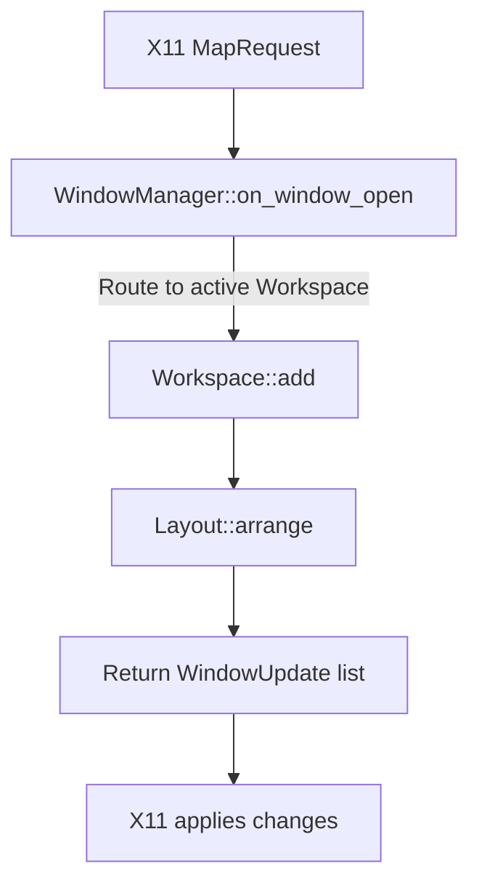

# Glo55 Window Manager Specification

## Overview

Glo55 is a tiling window manager for Linux X11 written in the V language. It features a master/stack layout similar to DWM with a unique styling system that supports image-based theming for windows and toolbars. The window manager is designed for personal use with a focus on visual customization through five different element types: solid colors, gradients, images, patterns, and text.

## Core Architecture

### Project Structure
```
glo55/
├── main.v              # Entry point with main() function
├── x11/                # X11 module: bindings and integration
│   ├── client.v        # Client-related code
│   ├── events.v        # Event-related code
│   └── screen.v        # Screen-related code
└── glo55/              # Glo55 module
    ├── config.v        # Configuration loading and management
    ├── drawing.v       # Drawing to an X11 graphics context
    ├── element.v       # Element accessors and rendering
    ├── layout.v        # Window layout interface and TilingLayout logic
    ├── theme.v         # Theme loading and variable replacement
    ├── window_manager.v # Core window management logic
    └── workspace.v     # Workspace and monitor management
```

### Key Components

#### Main (main.v)
- Entry point with `main()` function
- Orchestrates initialization sequence
- Starts main event loop

#### X11 Integration (x11/*.v)
- Custom X11 bindings for V
- Handles X11 connection and event processing
- Provides low-level window operations
- Fonts are loading using XftFontOpenName rather than XLoadFont.
- Text must be UTF-8, so XftDrawStringUtf8 is used to draw text.

Some basics:
```v
type Client = u64 // client is the term for an X11 window 
type Atom = u64
type X11Color = u64
```

X11 measurement types are: x int, y int, width u32, height u32.

#### Configuration (glo55/config.v)
- `load_config_into(mut ConfigTarget ct)` reads from TOML and sets properties
  in objects that implement the ConfigTarget interface.
- WindowManager, in this case, will implement the interface.

#### Configuration (glo55/drawing.v)
- `DrawingContext` struct with screen, root window, graphics context, everything
  needed to perform drawing operations. One drawing context is used globally
  for the entire window manager.
- `DrawingContext.create(conn &X11Connection, root Client, width u32, height u32)`
- `drawing_ctx.load_fonts(font_specs []string)` to load fonts. Returns an array
   of internal `Font` objects.
- Conversion of theme colors into X11 colors, to allow these colors to be used
  when drawing.

#### Element Rendering (glo55/element.v)
- `Element` struct with element type and properties
- `Element.from_toml()` static method for loading from a TOML object.
- `ele.render()` for solid, gradient, image, pattern, and text types

#### Layout System (glo55/layout.v)
- `Layout` interface (see later in this doc)
- `TilingLayout` struct that implements master/stack

#### Theme System (glo55/theme.v)
- `ThemeTarget` interface with theme data (arrays for `windows` and `toolbars`
   defined by the theme)
- `load_theme_into` function for loading theme.toml into an object that
  implements the ThemeTarget interface.
- `theme_get_fonts()` function for getting a string array of fonts to load,
  compatible with `drawing_ctx.load_fonts`.
- Element rendering methods for solid, gradient, image, pattern, and text types
- `ThemeArea` struct for positioning, the left/top/right/bottom settings.

#### Window Type (glo55/window.v)
- The `Window` type is the struct for internal representation of windows while
  the `Client` type is just the X11 window ID - which is stored in the `Window`
  struct.
- The `WindowSpec` type contains the coordinates for a window within a given
  workspace and a refernce to the `Window` object.

#### Window Manager (glo55/window_manager.v)
- `WindowManager` struct containing all monitor and window state
- Core window management operations
- `WindowUpdate` struct for describing window operations

#### Workspace Management (glo55/workspace.v)
- `Workspace` struct for per-monitor workspace definitions
- `Monitor` struct for multi-monitor support
- Window visibility and layout management

## Multi-Monitor Architecture

### Monitor Struct
Each monitor is independent and contains:
- Complete screen geometry
- Actual screen area available for tiled windows
- List of workspaces (number varies per monitor)
- Complete window list for all workspaces
- References to toolbar instances

### Workspace Behavior
- Workspaces are per-monitor (Monitor 1 might have 5 workspaces, Monitor 2 might have 2)
- Windows can belong to multiple workspaces
- When a workspace is shown, only its attached windows become visible
- Each workspace maintains its own master/stack layout ordering

## Configuration System

### File Structure
- **config.toml**: Main configuration file (keyboard shortcuts, workspace names)
- **theme.toml**: Theme configuration files (multiple, switchable)
- Theme switching: Edit config file and restart window manager

### Config.toml Structure
```toml
[[monitors]]
workspaces = ["main", "web", "code", "chat", "media"]

[[monitors]]
workspaces = ["terminal", "browser", "documents", "4", "5", "6", "7", "8", "9", "temp"]

[keybindings]
# Workspace switching
"Mod+1" = "workspace 1"
"Mod+2" = "workspace 2"
# ... etc

# Move window to workspace  
"Mod+Shift+1" = "move_window_to_workspace 1"
"Mod+Shift+2" = "move_window_to_workspace 2"
# ... etc

# Window focus navigation
"Mod+j" = "focus_down"
"Mod+k" = "focus_up" 
"Mod+h" = "focus_left"
"Mod+l" = "focus_right"

# Window movement
"Mod+Shift+j" = "move_down"
"Mod+Shift+k" = "move_up"
"Mod+Shift+h" = "move_left"
"Mod+Shift+l" = "move_right"

# Launch terminal
"Mod+Shift+Enter" = "exec kitty"
```

## Theme System

### Element Types
1. **Solid** - Solid color fill
2. **Gradient** - Linear gradient between fore/back colors
3. **Image** - Fixed-size image (PNG support via stbi module)
4. **Pattern** - Tiled image pattern
5. **Text** - Text content with template variables

### Common Element Properties
- **Positioning**: Rectangle with coordinates relative to area edges
  - Each coordinate (left, top, right, bottom) can be relative to any area edge
  - Fixed pixel values
- **Interaction**:
  - `action`: Optional clickable action (close, minimize, maximize)

### Color Properties (where applicable)
- `fore`: Foreground color (applies to solid, gradient, text elements)
- `back`: Background color (applies to solid, gradient, text elements - gradients use both colors)

### Element-Specific Properties
**Gradient Elements**:
- `direction`: Rotation in degrees (0° = left-to-right, 90° = top-to-bottom)

**Image/Pattern Elements**:
- `path`: Relative file path to source image

**Text Elements**:
- `content`: Text string with template variables
- `font`: Font name to use
- `size`: Font size in pixels
- Template variables: `$title` (window title), `$workspace` (current workspace name), `$time` (current time)

### Global Variables
- **Syntax**: `$variable_name` references values from `[vars]` section
- **Usage**: Can be used in any string property (colors, paths, text content)
- **Scope**: Available throughout the entire theme file

### State-Based Variables
- **Syntax**: `[windows.focused]`, `[windows.hover]`, `[windows.clicked]`, `[windows.collapsed]`
- **Toolbar Syntax**: `[toolbars.focused]`, `[toolbars.hover]`, `[toolbars.clicked]`, `[toolbars.collapsed]`
- **Purpose**: Override global variables when specific states are active
- **Inheritance**: State sections inherit from `[vars]` and can override individual variables
- **Priority**: State variables take precedence over global variables when the state is active

> **Important**: State-based variables are NOT elements. Elements can be named anything (e.g., `[windows.background]`, `[windows.my_custom_element]`), but state-based variables must use the reserved state keywords: `focused`, `hover`, `clicked`, `collapsed`.

### Theme.toml Structure
```toml
# Global variables that can be referenced throughout the theme
[vars]
primary_color = "#87ceeb"
secondary_color = "#4682b4"
background_color = "#2d2d2d"
text_color = "#ffffff"
close_icon_path = "icons/close.png"
pattern_path = "patterns/grid.png"

# The first window definition is the default for all windows.
# The `monitor`, for instance, can be set to apply a different window styling
# to windows on a different monitor.
[[windows]]
border_width = 2
window_gap = 4
focus_behavior = "follow_mouse"

# Window state overrides
[windows.focused]
primary_color = "#ffd700"
text_color = "#000000"

[windows.hover]
primary_color = "#add8e6"

[windows.clicked]
primary_color = "#ff6347"

[windows.collapsed]
primary_color = "#808080"

# Window elements
[windows.background]
type = "solid"
left = { edge = "left", offset = 0 }
top = { edge = "top", offset = 0 }
right = { edge = "right", offset = 0 }
bottom = { edge = "bottom", offset = 0 }
fore = "$background_color"
back = "$background_color"

[windows.border_top]
type = "gradient"
left = { edge = "left", offset = 0 }
top = { edge = "top", offset = 0 }
right = { edge = "right", offset = 0 }
bottom = { edge = "top", offset = 2 }
fore = "$primary_color"
back = "$secondary_color"
direction = 90

[[toolbars]]
monitor = 0
border_width = 1

# Toolbar state overrides
[toolbars.focused]
primary_color = "#ff69b4"

[toolbars.hover]
primary_color = "#dda0dd"

[toolbars.clicked]
primary_color = "#da70d6"

[toolbars.workspace_indicator]
type = "text"
left = { edge = "left", offset = 10 }
top = { edge = "top", offset = 4 }
right = { edge = "left", offset = 100 }
bottom = { edge = "bottom", offset = 4 }
fore = "$primary_color"
back = "#00000000"
content = "Workspace: $workspace"
font = "monospace"
size = 10

[[toolbars]]
monitor = 1
border_width = 1

[toolbars.clock]
type = "text"
left = { edge = "right", offset = -100 }
top = { edge = "top", offset = 4 }
right = { edge = "right", offset = -10 }
bottom = { edge = "bottom", offset = 4 }
fore = "$text_color"
back = "#00000000"
content = "$time"
font = "monospace"
size = 10
```

## Core Functionality

### Window Management
- **Layout**: Master/stack tiling layout only
- **Focus**: "Focus follows mouse movement" (no configuration)
- **States**: Always tiled (no minimize/maximize/fullscreen)
- **Operations**:
  - Window focus navigation (up/down/left/right)
  - Window movement within layout (up/down/left/right)

### Workspace Management
- **Count**: Up to 10 workspaces per monitor
- **Switching**: Key bindings (Mod+1 through Mod+0)
- **Window Moving**: Key bindings (Mod+Shift+1 through Mod+Shift+0)
- **Indicators**: Visual and keyboard-based workspace switching
- **Scope**: Key bindings operate on currently focused monitor

### Application Launching
- **Terminal**: Mod+Shift+Enter launches kitty
- **General**: Support for "exec" commands in key bindings

## Technical Implementation

### Dependencies
- **X11**: Custom binding implementation
- **Image Loading**: stbi module for V (PNG support only)
- **Configuration**: TOML parsing
- **Logging**: V's built-in `log` module (log.info, log.error)

### Event Handling
- **Processing**: Single main event loop
- **Routing**: Component-specific event handlers
- **Event Types**: Key presses, window creation/destruction, window focus, mouse movement, property changes

### Error Handling
- **Logging**: Use `log.error` for all errors
- **Recovery**: Exit on critical failures (X11 connection, config loading)
- **Application Issues**: No special handling for application-specific problems

### Initialization Sequence
1. Connect to X11 display
2. Check if another window manager is running
3. Load configuration (config.toml)
4. Load theme (theme.toml) and associated resources (fonts, images)
5. Build WindowManager struct from display information
6. Initialize cursor
7. Draw toolbars and window decorations
8. Begin handling events

## Integration Layers (External Dependencies)

### X11 Integration
- **Purpose**: Low-level window system interaction
- **Testing Strategy**: No unit tests - verify through functional testing
- **Risk Area**: Window creation, focus management, event routing

### Image Loading (stbi module)
- **Purpose**: PNG image loading for theming
- **Testing Strategy**: No unit tests - verify through theme rendering
- **Risk Area**: Image file format handling, memory management

### TOML Configuration Parsing
- **Purpose**: Configuration and theme file parsing
- **Testing Strategy**: No unit tests - verify through config/theme loading
- **Risk Area**: File format validation, type conversion

## Core Logic (Test Coverage Required)

### Layout Management
- Master/stack layout calculations
- Window positioning and sizing
- Gap and border width application

### Window Management Operations
- Focus navigation logic
- Window movement within layout
- Workspace window visibility

### Theme Rendering
- Element positioning calculations
- Color and gradient rendering
- Text rendering with variables
- Image and pattern tiling

### Configuration Management
- Key binding parsing and execution
- Workspace name management
- Theme switching logic

### Event Processing
- Event routing to appropriate handlers
- Key combination handling
- Window state synchronization

## Functional Testing Notes

The following areas should be verified through functional testing rather than unit tests:

1. **X11 Integration**
   - Window creation and management
   - Focus behavior verification
   - Event processing accuracy
   - Multi-monitor detection and handling

2. **Image Loading and Rendering**
   - PNG image loading from theme files
   - Image positioning and scaling
   - Pattern tiling functionality
   - Transparency handling

3. **Configuration Loading**
   - TOML file parsing correctness
   - Key binding functionality
   - Theme switching behavior
   - Error handling for malformed files

4. **End-to-End Workflow**
   - Complete initialization sequence
   - Window management operations
   - Workspace switching and window movement
   - Theme rendering and visual appearance

## Interface Specification

### Core Components

#### `WindowManager`
**Role**: Central event router and multi-monitor coordinator
**Internal Use Only** - no external consumers

```v
struct WindowManager {
  monitors []Monitor
  layouts []Layout
  draw DrawingContext
mut:
  windows []Window
  // ... other global properties
}
```

##### Methods:
- `on_window_open(c Client, rect ScreenRect, border_width u32)`
  - Adds window to internal list
  - Forwards to relevant `Monitor` based on what monitor is currently active
  - Called by the MaqRequestEvent handler.
  - The `rect` and `border_width` come from X11's XWindowAttributes, so we
    know the initial attributes of this window.
- Other events: `on_button_press`, `on_screen_resize`, `on_window_close`,
  `on_window_hover`, `on_key_press`, etc.
- `get_monitor_work_area(monitor_id MonitorId) ScreenRect`
  - Returns X11 coordinates of usable area (excludes panels)
- `get_monitor_at(x int, y int) ?MonitorId`
  - Determines physical monitor containing coordinates
- `set_monitor_as_active(monitor_id MonitorId)`
  - Sets the active Monitor (happens in `on_motion_notify`)

```v
type MonitorId = int   // the index of this monitor in the main array
```

#### `Monitor`
**Role**: Container for workspaces

```v
struct Monitor {
  workspaces []Workspace
  geometry ScreenRect
  work_area ScreenRect
}
```

#### `Window`
**Role**: Internal representation of managed windows

```v
struct Window {
  id Client
mut:
  title string
  flags u32     // bit fields for is_visible, is_floating
}
```

#### `WindowSpec`
**Role**: Instance of a window within a specific workspace

```v
struct WindowSpec {
  info &Window
mut:
  rect ScreenRect
}
```

#### `ScreenRect`
**Role**: X11 coordinate container

```v
struct ScreenRect {
    x int  // Absolute X11 physical pixels
    y int  // Absolute X11 physical pixels
    width u32
    height u32
}
```

#### `ThemeArea`
**Role**: Theme-specific positioning (before scaling)

```v
struct ThemeArea {
    base_x f32  // Relative to 800px width
    base_y f32  // Relative to 600px height
    width f32
    height f32
}
```

*Converted to `ScreenRect` via theme scaling rules before rendering*

#### `Workspace`
**Role**: Per-workspace layout and window management

```v
struct Workspace {
  title string
  layout &Layout
mut:
  windows []WindowSpec
}
```

##### Methods:

- `add(c Client, initial_rect ScreenRect)`
  - Forces new windows into layout's starting position (e.g. master pane)
  - Floating windows preserve requested position
  - Triggers `arrange`
- `remove(c Client)`
  - Triggers `arrange` after removal

### Coordinate System Rules

1. **All internal operations** use raw X11 physical pixel coordinates
2. **Theme scaling applies only at rendering time**:
   - Y-axis: Scaled proportionally to screen height
   - X-axis: Stretched to fill width (no scaling)
3. **No virtual coordinate systems** in WindowManager logic

### Layout Management Workflow



### Layout Interface

```v
interface Layout {
    arrange(windows []WindowSpec, work_area ScreenRect) []WindowUpdate
}
```

It is the responsibility of the `Workspace` to add and remove windows from its
internal `windows` array. (This includes moving windows up and down the list to
alter their position in the layout.) It then calls the `Layout` with its
window list and work area coordinates to actually arrange the windows, which
returns a list of window updates. Then, those updates gets passed (with the
workspace's window list) back to the `WindowManager` to tell X11 to make the
same updates.

Once X11 has successfully updated, the `Workspace` is told to apply the
`WindowUpdate` alterations to its internal `WindowSpec` objects. (So the objects
reflect their new positions.)

### Key Implementation Notes
- **Tiling layouts** recalculate all positions from scratch
- **Floating windows** ignore layout constraints (identified via `window.is_floating()`)
- **WindowUpdate** contains only windows requiring actual changes:
  ```v
  struct WindowUpdate {
      window_index int
      target_rect ScreenRect
  }
  ```

The `window_index` number refers to an index in a workspace's array of windows 
(passed into `arrange` as the `windows` parameter.)

### TilingLayout Implementation

```v
struct TilingLayout {
    master_ratio f32  // Master pane width ratio (e.g. 0.6 = 60% of screen)
    gap_width u32     // Configurable gap between windows
    border_width u32  // Window border width
}
```
